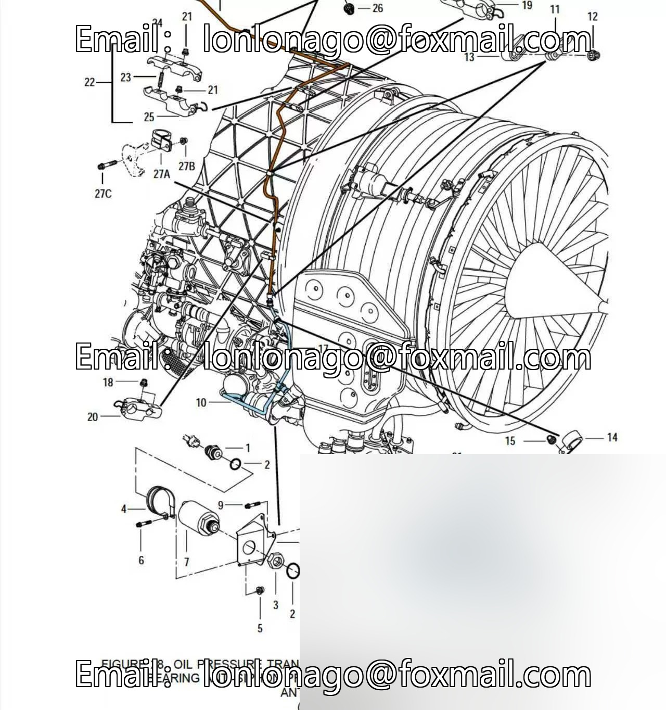
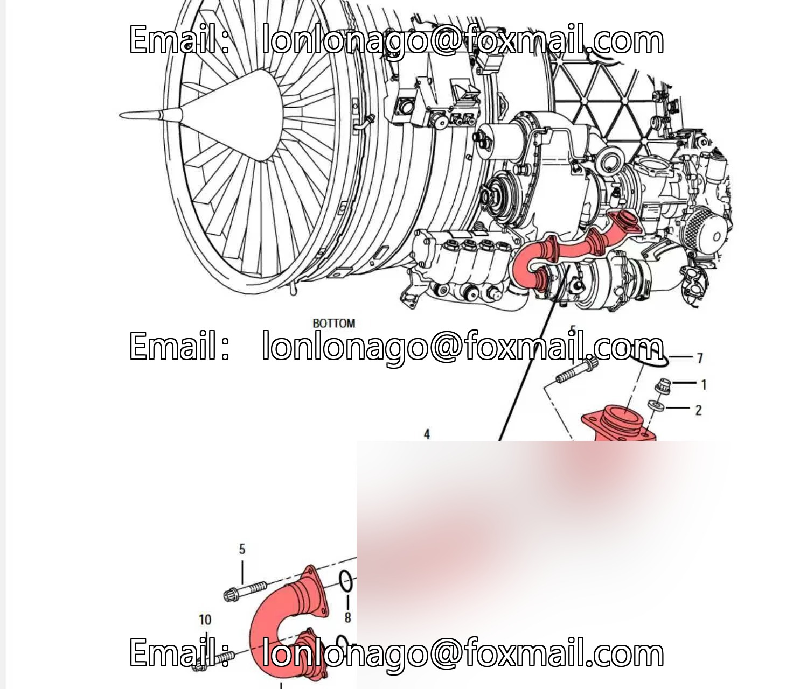
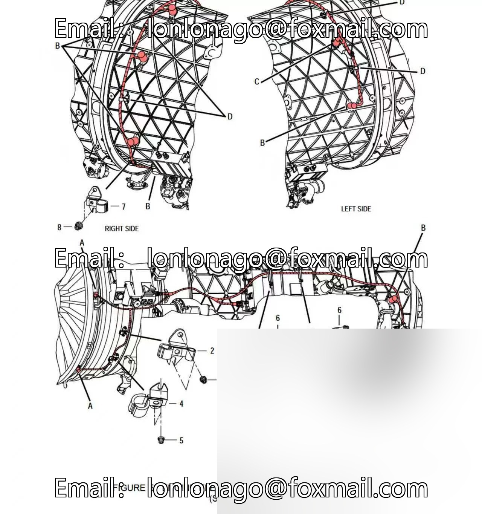
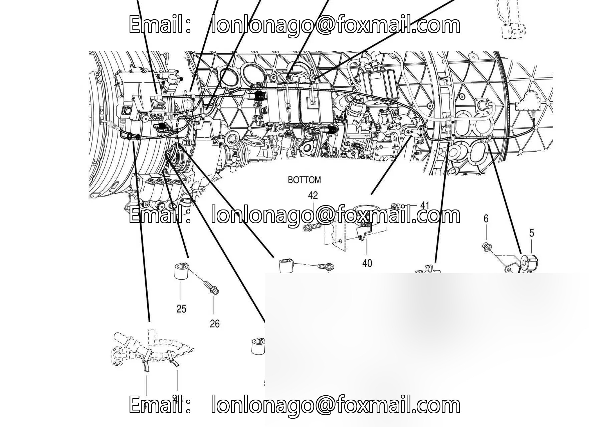
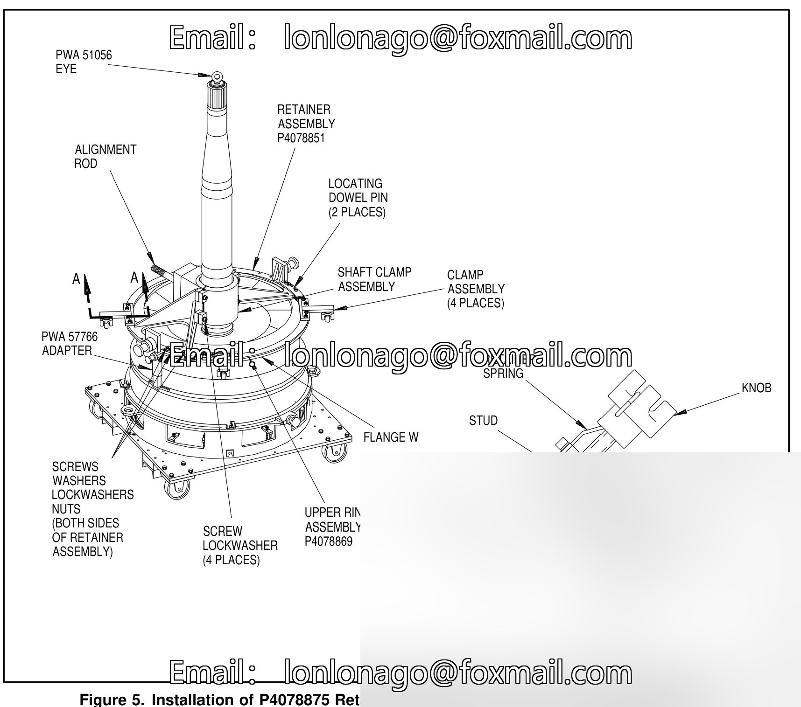

# F100-PW-229 engine design materials

## Body

F100-PW-229 engine design material F100-PW-229 aeronautical engine technical manual, Pratt & Whitney original official materials.

12 complete repair guides, totaling thousands of high-definition PDF files.

The materials include identifiers 27B, 27A and 27C, as well as oil pressure, bearing anti-siphon, bottom, left and right sides, engine structure, adjustment parts, fasteners, washers and locking washers.

<!-- AI_ENRICHED -->

## Images

## Payment

Here is a pay link on Stripe ( https://buy.stripe.com/3cs8yP7sY87d0vu9AB ). Please contact me lonlonago@foxmail.com after funding $89, and I will send you a complete data files , thank you!

